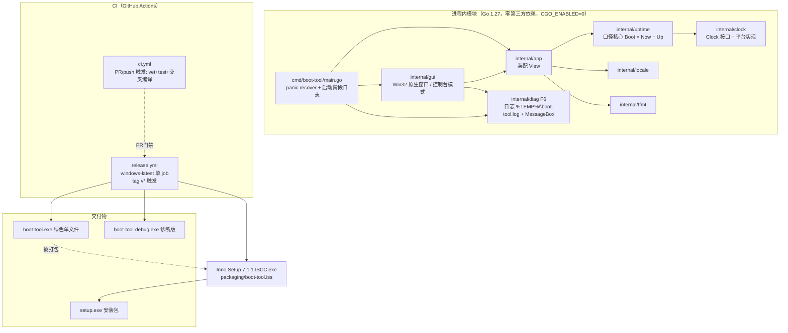
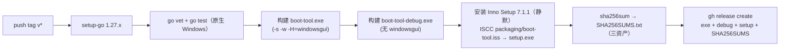

# 技术方案：Windows 开机小助手（boot-tool）· v2

> 依据 `docs/PRD.md`（v2，HYPE-44 评论 `01a1b8fc`）。本文档是实现与测试的唯一技术基准。
> v1 → v2：口径方案（§2）经上一轮验证**保持不变**；新增 §4（F5 双交付 setup.exe）、§5（F6/AC0 启动失败可见性）、§6（发布流水线重构）、§10（决策记录）、§11（分阶段实施计划）。

## 0. 结论先行

| # | 决策 | 结论 |
|---|---|---|
| 1 | 口径数据源 | `kernel32!QueryInterruptTime` 单调推导（不变，已冒烟对账） |
| 2 | 安装包选型（PRD §7 开放问题 1） | **Inno Setup 7.1.1**，`PrivilegesRequired=lowest` 免管理员安装 |
| 3 | 启动失败可见性（F6/AC0） | 采纳并规范化 Gia 参考实现 `7846057` 的 `internal/diag` 架构 |
| 4 | 发布流水线 | `release.yml` 改为**单 `windows-latest` job**，产 exe + 诊断版 + setup.exe + SHA256SUMS；另加 PR 触发 CI |
| 5 | 版本号 | 下一版 **v0.2.0**（新增交付物与失败可见性，semver 提 minor） |
| 6 | 分支 | 全程 `feature/HYPE-44`；本方案与 PRD v2 同步作为该分支上的 docs 提交 |

## 1. 现状盘点（`feature/HYPE-44` @ `edd7a7f`）

```
cmd/boot-tool/main.go        入口：装配 clock / locale / gui（12 行）
internal/clock/              Clock 接口 + 平台实现（Windows QueryInterruptTime / Linux /proc/uptime）+ Fake
internal/uptime/             核心口径：Snapshot{TakenAt, Up, Boot}，Boot = Now − Up 每次重算
internal/locale/             语言检测（GetUserDefaultUILanguage / LANG）
internal/tfmt/               中英时长与时间格式化
internal/app/                装配 View{Title, Up, Boot, Hint}
internal/gui/                Win32 原生窗口（user32 裸 syscall）；非 Windows 控制台模式
docs/                        PRD、本设计、测试计划
.github/workflows/release.yml 打 v* 标签 → ubuntu 构建 exe → GitHub Release
```

- **已验证**：口径方案 Linux 冒烟与 `uptime -s` 秒级一致；`go test ./...`、双平台 `go vet`、交叉编译 `-H=windowsgui` 全通过；Release v0.1.0 流水线跑通。
- **遗留**：①用户反馈"安装包打不开"根因未定位（SmartScreen / 下载损坏 / 静默失败三选一）；②交付形态只有单文件 exe，无安装包；③启动失败静默退出（GUI 子系统无任何提示）。
- **WIP 输入**：Gia 参考实现 `7846057`（`internal/diag` 启动分阶段日志 + MessageBox + panic 兜底 + 诊断版构建），**未推送**，位于另一工作副本的本地 `feature/HYPE-44`。本方案 §5 采纳其架构并做两处规范化；代码落码归 `started_3`（cherry-pick 或重做，冲突以本设计为准）。

## 2. 时钟口径设计（对应 PRD §2 四条硬性要求，v1 验证通过、不变）

### 2.1 数据源

| 数据 | API | 说明 |
|---|---|---|
| 运行时长（含睡眠） | `kernel32!QueryInterruptTime` | 自系统启动的 100ns 单调计数，**含睡眠/休眠**，不受墙钟/时区/夏令时影响 |
| 墙钟 | `time.Now()` | 仅用于展示与推导开机时刻绝对值 |
| 开机时刻（推导） | `Boot = Now − Uptime` | 每次刷新实时推导，不单独存储 |

WMI `LastBootUpTime` / `systeminfo` **仅作人工对账基准**，不作运行时依赖（延迟数百 ms～秒级，威胁 AC0/AC6 的 3 秒出数）。

### 2.2 四条硬性要求逐条实现方式

1. **与任务管理器"正常运行时间"同口径（含睡眠）**：`QueryInterruptTime` 含 suspend 时间，语义即"含睡眠的正常运行时间"；启动后与权威来源对账（test-plan AC1/AC3）。
2. **睡眠/唤醒连续不跳变**：单调计数睡眠期间照常推进，唤醒后从同一计数续算——无重置路径、无累加状态可丢；`WM_TIMER` 每秒刷新，唤醒后下一 tick 即连续值。
3. **持久化原子性**：本期无持久化数据，标注 N/A（PRD v2）；P1 "累计开机时长"按 `写临时文件 + os.Rename`（NTFS 同卷原子替换）+ 校验和 + 断电自愈实现，方案在 §7 预留。
4. **时区/夏令时不跳变**：全部计算基于绝对时刻与单调时长；`Boot = Now − Uptime` 与 `Now` 同时区，时区切换只改 `t.Format` 呈现。NTP 步进只影响 `Boot` 绝对展示（与系统权威来源同向漂移），运行时长完全不受影响。

### 2.3 精度分析（AC1/AC2）

- 运行时长分辨率 100ns、无累积误差 → 7 天无漂移。
- 开机时刻 = 墙钟 − 运行时长：墙钟被 NTP 校准时与系统自身推导同向移动，保持 ≤1s 对齐。
- 首屏：窗口创建前先取一次快照，首帧即带数据；启动到出窗 <300ms 量级（目标 ≤3s，余量 10 倍）。

## 3. 总体架构



平台差异收敛在 `internal/clock`、`internal/gui`（build tag）与 `internal/diag`（build tag）三个包；口径逻辑（`uptime`/`tfmt`/`app`）平台无关，Linux 可直接单测。

## 4. F5 双交付：setup.exe 安装包方案

### 4.1 选型：Inno Setup 7.1.1（主推荐）

| 维度 | 依据 |
|---|---|
| 版本 | **Inno Setup 7.1.1**（2026-10-28 发布，`innosetup-7.1.1-x64.exe`，当前最新稳定版；CI 中固定此版本安装，避免漂移） |
| 许可 | Inno Setup License：明文允许"任何人出于任何目的使用，包括商业应用"，分发由其编译出的安装包无需付费/额外授权 |
| 免管理员 | `PrivilegesRequired=lowest` → 按用户安装到 `%LOCALAPPDATA%\Programs\BootTool`，不弹 UAC，对齐 PRD §6"无管理员权限要求"；控制面板/设置"应用和功能"自动出现卸载项（AC8） |
| CI 集成 | `windows-latest` runner 上 `innosetup-7.1.1-x64.exe /VERYSILENT /NORESTART` 安装后调 `ISCC.exe setup\boot-tool.iss`，纯命令行、无交互 |
| 脚本可维护 | `.iss` 为声明式脚本（约 60 行），随仓库评审 |

**`packaging/boot-tool.iss` 契约要点**：

```ini
; 关键项（完整脚本由 started_3 编写）
AppId={{7B3E2A64-5C1D-4A8F-9E20-HYPE44BOOT01}   ; 固定 GUID，升级覆盖同一安装位
AppName=开机小助手
AppVersion={#MyAppVersion}                      ; 由 CI 传入 tag 版本号
DefaultDirName={localappdata}\Programs\BootTool ; 免管理员
PrivilegesRequired=lowest
OutputBaseFilename=setup
SetupIconFile=assets\app.ico                    ; 若无图标资源则省略该行，用系统默认
[Files] Source: "dist\boot-tool.exe"; DestDir: "{app}"; Flags: ignoreversion
[Icons]
  Name: "{autoprograms}\开机小助手"; Filename: "{app}\boot-tool.exe"
  Name: "{autodesktop}\开机小助手";  Filename: "{app}\boot-tool.exe"; Tasks: desktopicon
[Run]  Filename: "{app}\boot-tool.exe"; Flags: nowait postinstall skipifsilent
[UninstallDelete] ; 仅清理本程序文件，不动用户数据
```

安装后行为：开始菜单出现"开机小助手"、可选桌面快捷方式、卸载项存在；安装结束可选立即运行（AC8 + AC0）。

### 4.2 备选与被否决方案

| 方案 | 结论 | 取舍 |
|---|---|---|
| **NSIS 3.x** | 备选 | 同样免费、CI 可用（`makensis`）；但 NSIS 脚本为命令式汇编风格、可读性与评审友好度低于 `.iss`，且免管理员/卸载注册表细节需手写更多样板。功能上无优势，不选 |
| **WiX / MSI（含 Burn）** | 否决 | 面向企业 GPO/组策略分发场景；对本工具是过度设计，构建链复杂（需 `candle/light` 或 WixToolset SDK），且 MSI 的 UI 与按用户安装组合易踩权限坑 |
| **自写安装逻辑（解压+快捷方式）** | 否决 | 无标准卸载入口（AC8 要求"控制面板可卸载"），违背平台惯例 |
| **MSIX / 商店分发** | 否决 | 需代码签名证书与开发者账号，本项目无签名预算；SmartScreen 问题不因 MSIX 根除（签名属长期课题，见 §12 风险 3） |

### 4.3 双交付一致性

- `setup.exe` 内嵌的 `boot-tool.exe` 与 Release 中绿色版**同一构建产物**（CI 中先构建、后打包，不做二次编译）。
- 两者共享同一 `AppVersion`（来自 tag），`SHA256SUMS.txt` 覆盖全部三个资产（exe / 诊断版 / setup.exe）。

## 5. F6/AC0 启动失败可见性（采纳 WIP `7846057`，两处规范化）

### 5.1 模块契约 `internal/diag`

| 函数 | 契约 |
|---|---|
| `diag.Logf(format, args...)` | 追加一行（时间戳 + 内容）到 `%TEMP%\boot-tool.log`；有控制台时镜像 stdout；**永不 panic、失败静默**（诊断不得反噬主程序） |
| `diag.Alert(msg)` | Windows：`MessageBoxW(MB_OK|MB_ICONERROR|MB_SYSTEMMODAL)` 模态错误框；非 Windows：stderr |
| `diag.Fatal(r)` | 记录 panic + 栈到日志，再 `Alert` 用户可读文案（含日志路径），由 `main` 的 `recover` 调用 |

**规范化 1（相对 WIP）**：日志文件大小上限 **512 KB**——超过则轮转为 `boot-tool.log.1`（旧文件覆盖），防止长期反复启动导致 `%TEMP%` 无限增长。正常路径只在启动/退出/错误时写入（每秒刷新**不写日志**），实际增长可忽略，此为防御性上限。

**规范化 2（相对 WIP）**：启动阶段命名固定为 `stage` 序列，诊断版逐行打印，形成可对表的契约：

```
stage: version-banner → clock → locale → window-class → window → controls → timer → entering-message-loop
```

任一 stage 失败 ⇒ 写日志 `stage xxx FAILED: <err>` + `Alert` + 非零退出，**禁止无声退出**（AC0）。

### 5.2 失败路径清单（全部可见）

| 失败点 | 处理 |
|---|---|
| `main` 未捕获 panic | `defer recover` → `diag.Fatal`（对话框 + 日志 + 栈） |
| `RegisterClassExW` / `CreateWindowExW` 失败 | `diag.Alert`（含 Win32 错误码）+ 日志 + 退出 |
| 控件/字体创建失败 | 字体失败降级系统默认字体（继续运行）；控件失败 → Alert + 退出 |
| `QueryInterruptTime` 加载失败 | Alert + 退出（Win8+ 理论不存在，防御） |
| 日志文件不可写 | 降级：仅 MessageBox（Alert 不依赖日志成功） |

### 5.3 诊断版 `boot-tool-debug.exe`

- 同一份 `cmd/boot-tool` 源码，仅构建参数不同：**不加 `-H=windowsgui`**（控制台子系统），`diag.Logf` 镜像到 stdout 即逐步打印启动过程。
- 定位流程（README「打不开？」章节）：正式版打不开 → 跑诊断版 → 黑窗最后一条 stage 即卡点；配合 `%TEMP%\boot-tool.log` 反馈。
- README 故障排查章节（SmartScreen 放行、右键解除锁定、`certutil` SHA256 校验、日志位置）文案已由 WIP 预备，`started_3/4` 随代码采纳。

## 6. CI / 发布流水线

### 6.1 `ci.yml`（新增，PR/push 门禁）

`ubuntu-latest`：`go vet ./...` → `go test ./...` → `GOOS=windows go vet ./...` → 交叉编译冒烟（产物丢弃）。对 `main` 与 PR 触发，防止 tag 发布时才发现坏提交（上一轮 Gia 复核建议）。

### 6.2 `release.yml`（重构为单 `windows-latest` job）



**决策（ADR-2）**：单 `windows-latest` job，而非"ubuntu 构建 + windows 打包"双 job。
- 取：实现简单（无 artifact 传递/依赖顺序），原生 Windows 上 `go vet/test` 直接覆盖目标平台，Inno Setup 就地可用；本仓库规模下分钟数成本可忽略。
- 舍：windows runner 比 ubuntu 慢且消耗 windows 分钟数——对本项目（每日个位数构建）不构成问题。
- 回滚：恢复 ubuntu 单 job 即可（git 历史保留原 `release.yml`），绿色 exe 的构建方式不变。

**版本注入**：`AppVersion` 与 `main.go` 的 `version` 常量均由 CI 从 tag 推导（`ISCC /DMyAppVersion=${GITHUB_REF_NAME#v}`；Go 侧 `-ldflags "-X main.version=..."`），避免人工双处改版本。

## 7. 数据模型与存储

- **本期（P0）**：**无任何持久化**——进程内存中只有每秒重算的 `Snapshot`，无文件、无注册表、无网络。这直接满足硬性要求 3 的"本期 N/A"。
- **P1 预留**（不实现，仅锁定方案防走样）：`%LOCALAPPDATA%\BootTool\sessions.json`，原子写 = 写 `sessions.json.tmp` → `os.Rename` → 覆盖前校验 JSON + 版本号字段；启动读取失败则备份为 `.corrupt` 后重建，断电自愈。
- **注册表**：仅安装器写标准卸载键（`HKCU\...\Uninstall\{AppId}`，Inno Setup 自动管理），程序运行时不读写注册表。

## 8. 接口契约（模块边界）

```go
// internal/clock —— 口径的唯一时间来源
type Clock interface {
    Now() time.Time        // 墙钟，仅展示/推导
    Uptime() time.Duration // 单调、含睡眠；绝不为负
}

// internal/uptime
func Read(c clock.Clock) Snapshot // Snapshot{TakenAt, Up, Boot=Now-Up}，Boot 每次重算

// internal/app
func New(clk clock.Clock, lang locale.Lang) *App
func (a *App) View() View // View{Title, Up, Boot, Hint} —— UI 唯一输入

// internal/diag —— 失败可见性唯一出口
func Logf(format string, args ...any) // 永不失败、永不 panic
func Alert(msg string)                 // 必达用户（MessageBox / stderr）
func Fatal(r any)                      // panic 兜底
```

**Release 资产契约**（QA/运维验收依据）：`boot-tool.exe`、`boot-tool-debug.exe`、`setup.exe`、`SHA256SUMS.txt`（覆盖前三者），全部挂同一 tag 的 GitHub Release。

## 9. 验收标准 → 方案映射

| AC | 方案落点 | 验证方式 |
|---|---|---|
| AC0 可启动性（硬性） | §5 全部失败路径可见；§4.1 免管理员安装 | 真机双击两入口 ≤3s 出窗；故意断权限/坏路径复现对话框 |
| AC1 ≤1s 对齐 | §2.1/§2.3 | 真机对账任务管理器（冷启/重启/睡眠恢复各一次） |
| AC2 7 天无漂移 | §2.3 100ns 单调计数 | 单测（Fake 推进 7 天）+ 真机长跑抽查 |
| AC3 睡眠连续 | §2.2 条 2 | 单测（Fake Advance 含睡眠）+ 真机睡 4h |
| AC4 | 本期 N/A（P1） | — |
| AC5 时区切换 | §2.2 条 4；`WM_TIMECHANGE` 立即刷新 | 单测 + 真机切时区 |
| AC6 3 秒出数/资源 | §2.3 首帧快照；单线程 + 1Hz `WM_TIMER`，无轮询无网络 | 真机秒表 + 任务管理器采样回填 |
| AC7 中英文 | `locale` + `tfmt`；安装器语言跟随系统 | 单测全用例 + 中/英系统各验一次 |
| AC8 安装包 | §4.1 `.iss` 契约 | Win10/11 各走一遍安装→快捷方式→卸载 |

## 10. 决策记录（ADR）

| # | 背景 | 决策 | 后果 |
|---|---|---|---|
| ADR-1 | PRD §7 遗留问题 1：安装器选型，架构师提出、Gia 复核 | **Inno Setup 7.1.1**（备选 NSIS 3.x，否决 WiX/MSI/自写，理由见 §4.2） | CI 多一步静默安装；`.iss` 进仓评审；免管理员安装对齐 PRD §6 |
| ADR-2 | 发布流水线要产 3 资产 + 校验 | **单 `windows-latest` job**，ubuntu 双 job 为备选（§6.2） | 简单可靠；消耗 windows 分钟数（可忽略）；回滚 = git 恢复原 workflow |
| ADR-3 | 下一版本号 | **v0.2.0**（新增 setup.exe 交付物与 F6 失败可见性属功能增强；v0.1.0 已发布不可复用） | WIP 文案中 "0.1.1" 需随落码改为 0.2.0；PRD/README 同步 |
| ADR-4 | WIP `7846057` 如何处置 | **采纳其 `internal/diag` 架构**，按 §5 两处规范化（512KB 轮转、stage 契约）；代码由 `started_3` cherry-pick 或重做，冲突以本文档为准 | 不重复造轮子；诊断能力成为 AC0 的实现基础 |
| ADR-5 | PRD v2 与仓库 `docs/PRD.md` 不一致 | 架构师随本方案**同步提交 PRD v2**（PRD §3 同步提醒授权） | 仓库文档恢复为唯一基线，后续阶段不再依赖评论比对 |

## 11. 分阶段实施计划（不跳步，角色即工作流阶段）

| 阶段 | 角色 | 工作内容 | 风险 | 回滚 | 验证标准 |
|---|---|---|---|---|---|
| `started_3` 后端 | 资深后端研发工程师 | ① cherry-pick/重做 `7846057` 并按 §5 规范化（diag + main + gui 失败路径）；② `packaging/boot-tool.iss` + `ci.yml` + `release.yml` 重构；③ README 故障排查章节、版本号 v0.2.0；④ 单测补 diag 不 panic 用例 | 与 WIP 在 `docs/design.md`/`README` 的文本冲突；Inno Setup 静默安装参数差异 | 全部改动为增量提交，`git revert` 单提交即可回退；exe 构建路径不变 | `go test ./...`、双平台 `go vet`、交叉编译、`ISCC` 本地/CI 出 `setup.exe` |
| `started_4` 前端 | 资深前端研发工程师 | 本项目 GUI 为进程内 Win32（Go），**确无独立前端部分**：由该阶段复核 GUI 显示层（窗口/控件/字体/中英切换）与 F5 安装后入口表现，无代码则明确记录跳过 | 误判为"有前端"导致空转 | — | GUI 相关单测/编译通过，或阶段内明确"无前端工作"留痕 |
| `qa` | 资深测试工程师 | 按 `docs/test-plan.md` 独立执行：新增 **B0（AC0 可启动性）** 与 **B8（AC8 安装包）** 步骤（WIP 已预备 B0 文案），回填 AC6 基线 | 真机环境缺失（本运行时无法跑 Windows） | — | AC0/AC1/2/3/5/6/7/8 逐项留痕；AC0 不通过则阻塞 |
| `started_5` 运维 | 资深运维工程师 | PR 合入 `main`、打 tag `v0.2.0` 触发 Release、核对四资产与 SHA256 | tag 流水线失败 | 保留 v0.1.0 Release 不动；失败可删 tag 重打（同一版本号首次发布） | Release 四资产齐全、SHA256 一致、真机安装启动通过 |

> 顺序说明：`qa` 必须在 `started_5` 之前（上一轮顺序违规的教训）；本阶段（`started_2`）交付后由 Gia 复核放行 `started_3`。

## 12. 风险与缓解

1. **根因未定位**（"打不开"三选一）：F6 全路径可见 + 诊断版 + README 排障构成兜底，任何一种根因下用户可自救且可回传卡点；若用户回贴诊断版截图可直接定根因。
2. **Inno Setup CI 安装失败**（下载源/静默参数）：CI 中固定 7.1.1 直连 GitHub Release 资产（带 sha256 校验）；失败则 `release.yml` 整体失败，绿色 exe 发布路径独立保留可临时降级为仅发 exe。
3. **SmartScreen 拦截（未签名）**：本期无代码签名证书（预算/账号未提供），属已知限制；缓解 = README 放行指引 + SHA256 校验 + 安装包签名作为 P1+ 课题（需购买代码签名证书或启用 Azure Trusted Signing）。
4. **免管理员安装路径被企业策略拦截**：`PrivilegesRequired=lowest` 下写入的是用户目录，策略风险极低；如遇 AppLocker 拦截，错误对话框 + 日志可直接定位（F6 覆盖）。
5. **双工作副本分支分叉**（WIP `7846057` 未推送 vs 本方案 docs 提交已推送）：`started_3` 开工时先 `git fetch` 并 rebase WIP 到最新 `feature/HYPE-44`，冲突以本设计文档为准；这是已知且已给出解决路径的分叉，不阻塞。

## 13. 假设清单（供复核推翻）

| 假设 | 依据/验证方式 |
|---|---|
| Inno Setup 7.1.1 在 `windows-latest` 可静默安装并 `ISCC` 出包 | 官方 Release 资产 + 标准 `/VERYSILENT` 参数；`started_3` 首次 CI 运行即验证 |
| 免管理员（`{localappdata}`）安装满足用户对"安装包"的预期 | PRD §6 无管理员权限要求；若用户反馈需全机安装，改 `PrivilegesRequired=admin` 一行即可（回滚成本极低） |
| AC6 资源指标实测可达成 | 无后台轮询、1Hz 单线程重算，预期远低于阈值；真机回填 |
| 下一版本 v0.2.0 | ADR-3，Gia 复核可改 |

## 14. `started_3` 落码记录（方案复核结论 + 实现说明）

> 本节由 `started_3` 后端研发在动手前复核 §1–§13 后追加，作为实现与 QA 的对表依据；正文其余章节为唯一基准，冲突时以本节的"复核结论"为准。

### 14.1 方案复核：通过，5 处澄清/修正

| # | 位置 | 发现 | 处理 |
|---|---|---|---|
| 1 | §5.1 stage 契约 vs WIP `7846057` 的 `SetTimer` 非致命处理 | 两者冲突：WIP 只记日志继续跑 | **按 §5.1 执行**——无 1s 定时器则时长冻结为过期值 = 静默错误数据，`timer` stage 失败即失败可见退出 |
| 2 | §4.1 `AppId` 示例 `...-HYPE44BOOT01` | 非法 GUID（含非 hex 字符） | 换成合法固定 GUID `{A7C4E9D2-51B8-4F3A-9C61-2D8E44B7F013}`；setup.exe 为首发，改此值无升级残留风险。锁定后勿再改 |
| 3 | §4.1 内部路径不一致（`setup\boot-tool.iss` vs `packaging/boot-tool.iss`） | 两处写法并存 | 统一为 **`packaging/boot-tool.iss`**（§3、§6.2、§11 均用此路径），`Source` 用 `..\dist\boot-tool.exe` |
| 4 | §6.2 版本注入 `-X main.version` | WIP 里 `version` 是 `const`，ldflags 无法覆盖 | 改为 `var version = "0.2.0"`；CI 从 tag 覆盖，tag 非 `vX.Y.Z` 直接失败（ADR-3） |
| 5 | §5.2 "`QueryInterruptTime` 加载失败 → 退出" 无落点 | `clock.New()` 不返回错误，无法表达该失败 | 扩展为 `clock.New() (Clock, error)`（§8 未规定该签名），Windows 侧 `Find()` 失败即报错；Linux 侧永不失败 |

另两处按 §13"验证方式"落实的实现细节：**Inno Setup 资产取官方 GitHub Release 直链**（`jrsoftware/issrc` tag `is-7_1_1`，带 sha256 `8a5a67…b3f0` 固定校验，比 `files.jrsoftware.org` 更可审计）；**`ci.yml` 增加 `installer`（windows-latest）job**，使 §13 第 1 条假设在本阶段即可验证，而不是等到打 tag（§6.1 的 ubuntu job 保持不变，`installer` 为其并列补充）。

`ci.yml` 触发面在 §6.1 基础上扩为 `main` + PR + **`feature/**` 推送**：PR 由 `started_5` 创建（§11），本阶段没有 PR 可触发，而 §13 要求的"首次 CI 运行"必须落在 `started_3`——推送触发即为其替代路径；`main` 与 PR 两个原有触发面不变，门禁强度只增不减。

### 14.2 WIP `7846057` 处置：**架构采纳、代码重做**（ADR-4 允许的两条路径之一）

- 采纳：`internal/diag` 三分工（`Logf` / `Alert` / `Fatal`）、失败路径清单、诊断版构建思路、README 排障章节文案骨架。
- 重做原因：WIP 的日志行是自由文本（`stage: class registered`、`stage: window shown...`），与 §5.1 固定 stage 序列对不上；README/test-plan/design 的文案基于 v0.1.1 与 v1 文档，与 v2 冲突。按 §11"冲突以本文档为准"，不 cherry-pick，按 §5 规范化后重写。
- WIP 的 `docs/test-plan.md` B0、`docs/design.md` §3.1 一行**未并入**：B0/B8 属 `qa` 阶段产出（§11）；`docs/design.md` §3.1 已被 v2 重写，无需回填。

### 14.3 交付物与验证状态

| 交付 | 文件 | 本地验证 | 说明 |
|---|---|---|---|
| F6/AC0 失败可见性 | `internal/diag/`（diag.go / diag_windows.go / diag_proc.go + 2 个测试文件）、`cmd/boot-tool/main.go`、`internal/gui/*` | `go test ./...`、双平台 `go vet`、交叉编译 ✅ | stage 失败 = 日志 `stage: <name> FAILED: <err>` + 中英双语对话框（含日志路径）+ 退出码 1 |
| 日志 512KB 轮转 | `internal/diag/diag.go` | 单测 `TestLogRotatesAtCap` ✅ | 超限滚动到 `boot-tool.log.1`（覆盖旧副本） |
| diag 不 panic 单测 | `internal/diag/diag_test.go`、`diag_alert_test.go` | 6 个用例 ✅ | Windows 侧对话框用例以 `//go:build !windows` 隔离，避免阻塞 `release.yml` 的 Windows 测试；真机行为归 B0 |
| 安装包 | `packaging/boot-tool.iss`（UTF-8 **带 BOM**） | 仅静态审查 | **本机为 Linux，无法运行 ISCC —— `setup.exe` 编译属 CI 验证项**（`ci.yml` installer job） |
| CI | `.github/workflows/ci.yml` | YAML 静态审查 | ubuntu：vet/test/交叉编译；windows：Inno 静默安装 + ISCC 出包 |
| 发布 | `.github/workflows/release.yml` | YAML 静态审查 | 单 `windows-latest` job：测试 → 双 exe → setup.exe → 三资产 SHA256 → `gh release create`；**首次跑通依赖 `started_5` 打 tag** |
| 文档 | `README.md`（三资产表 + 「打不开？」排障 + 构建说明）、`docs/design.md` 本节、`.gitignore` | — | 版本文案统一为 **0.2.0**（ADR-3） |

**QA 对表要点**：诊断版黑窗/日志中的 stage 行固定为 `stage: version-banner → clock → locale → window-class → window → controls → timer → entering-message-loop`，成功行形如 `stage: window ok`，失败行形如 `stage: controls FAILED: <err>`；B0 期望"逐行打印且无 `FAILED`"即以该序列为判据（注意连字符写法，以本节为准）。
