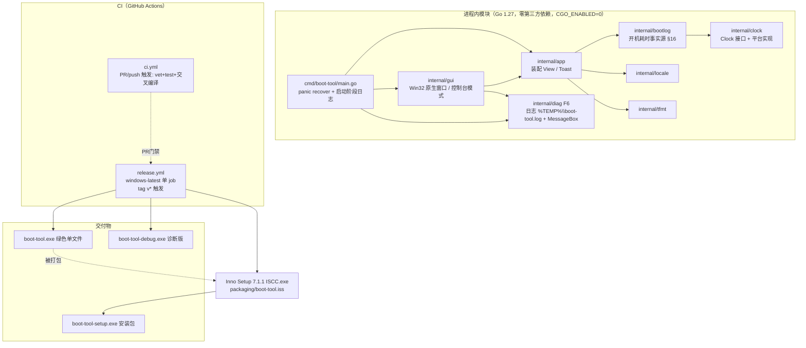
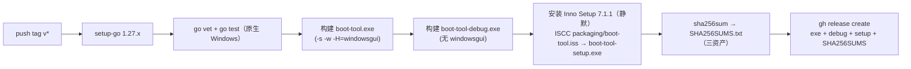
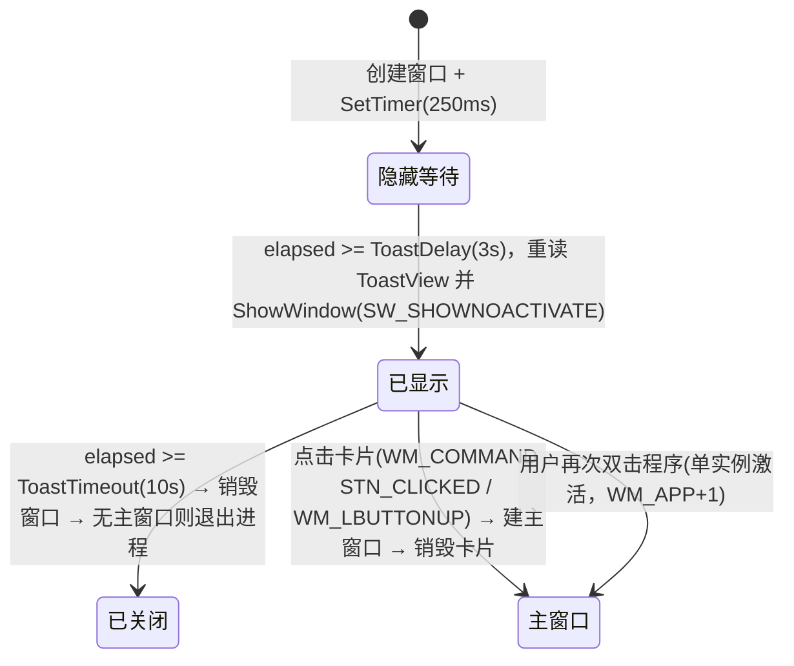

# 技术方案：Windows 开机小助手（boot-tool）· v3

> 依据 `docs/PRD.md`（v3，HYPE-46）。本文档是实现与测试的唯一技术基准。
> v1 → v2：口径方案（§2）经上一轮验证**保持不变**；新增 §4（F5 双交付）、§5（F6/AC0 启动失败可见性）、§6（发布流水线重构）、§10（决策记录）、§11（分阶段实施计划）。
> **v2 → v3（HYPE-46，2026-11-08）**：§2.1 时钟数据源改为**分层降级**（修复 kernel32 不再导出 `QueryInterruptTime` 导致的启动失败）；§5.1 stage 契约补 `single-instance` 与弹窗序列；新增 **§15**（F7 开机自启、F8 右下角弹窗、单实例激活、安装包产物更名）；§7/§8/§9/§10 同步。
> **v3 → v4（HYPE-46，2026-11-08，用户反馈"刚开机显示一个多小时"）**：新增 **§16**——开机耗时/开机完成改为**读取系统事件日志打点**（`Kernel-Boot 27` / `Kernel-General 12` → `Winlogon 7001`），内核计数退居"读不到日志时的兜底"；原因是**快速启动（BootType=1）会让内核计数跨关机连续累计**，用它推导的"开机耗时"会凭空多出上一次会话的几小时。§5.1 stage 增 `boot-record`，§8/§9/§10 同步。

## 0. 结论先行

| # | 决策 | 结论 |
|---|---|---|
| 1 | 口径数据源 | **分层降级**：`kernelbase!QueryInterruptTime` → `kernel32!QueryInterruptTime` → `kernel32!GetTickCount64`；生效数据源写日志（§2.1、§15.3） |
| 2 | 安装包选型（PRD §7 开放问题 1） | **Inno Setup 7.1.1**，`PrivilegesRequired=lowest` 免管理员安装 |
| 3 | 启动失败可见性（F6/AC0） | 采纳并规范化 Gia 参考实现 `7846057` 的 `internal/diag` 架构 |
| 4 | 发布流水线 | `release.yml` 改为**单 `windows-latest` job**，产 exe + 诊断版 + `boot-tool-setup.exe` + SHA256SUMS；另加 PR 触发 CI |
| 5 | 版本号 | 本版 **v0.3.0**（v0.2.0 已由 HYPE-44 交付；新增自启 + 弹窗 + 兼容层属功能增强，semver 提 minor） |
| 6 | 分支 | `feature/HYPE-46`（HYPE-44 取消后本 issue 接手，基线含 v0.2.0 全部代码） |
| 7 | 开机自启（F7） | `HKCU\Software\Microsoft\Windows\CurrentVersion\Run` 单值 `BootTool`，命令带 `--autostart`；由安装器写入，程序也提供 `--install-startup/--uninstall-startup`（§15.1） |
| 8 | 启动弹窗（F8） | 无第三方 UI 库的原生 Win32 卡片：置顶工具窗口 + 不抢焦点 + 主屏工作区右下角 + 3s 延迟/10s 停留 + 点击进主窗口（§15.2） |
| 9 | 安装包产物名 | `boot-tool-setup.exe`（Inno Setup 7 对 `setup.exe` 有兼容层 shim 警告，安全面更优，ADR-6） |
| 10 | 开机耗时数据源（v4） | **系统事件日志打点**：`Kernel-Boot 27`/`Kernel-General 12`（启动）→ `Winlogon 7001`（登录完成）；内核计数不再作为界面数字（ADR-9） |
| 11 | "已运行"起点（v4） | 自**登录完成**起算，用单调计数推进；不再等同任务管理器"正常运行时间"（ADR-10） |
| 12 | 日志不可读（v4） | 显示"未知"+ 风险提示，内核计时仅作兜底并在界面标注（ADR-11） |


## 1. 现状盘点（`feature/HYPE-44` @ `edd7a7f`）

```
cmd/boot-tool/main.go        入口：装配 clock / bootlog / locale / gui
internal/clock/              Clock 接口 + 平台实现（Windows QueryInterruptTime / Linux /proc/uptime）+ Fake
internal/bootlog/            v4 新增：本次开机耗时/完成时刻（读 System 事件日志打点，见 §16）
internal/locale/             语言检测（GetUserDefaultUILanguage / LANG）
internal/tfmt/               中英时长与时间格式化
internal/app/                装配 View{Title, Up, BootDur, BootDone, Hint}（v4）
internal/gui/                Win32 原生窗口（user32 裸 syscall）；非 Windows 控制台模式
docs/                        PRD、本设计、测试计划
.github/workflows/release.yml 打 v* 标签 → ubuntu 构建 exe → GitHub Release
```

- **已验证**：口径方案 Linux 冒烟与 `uptime -s` 秒级一致；`go test ./...`、双平台 `go vet`、交叉编译 `-H=windowsgui` 全通过；Release v0.1.0 流水线跑通。
- **遗留**：①用户反馈"安装包打不开"根因未定位（SmartScreen / 下载损坏 / 静默失败三选一）；②交付形态只有单文件 exe，无安装包；③启动失败静默退出（GUI 子系统无任何提示）。
- **WIP 输入**：Gia 参考实现 `7846057`（`internal/diag` 启动分阶段日志 + MessageBox + panic 兜底 + 诊断版构建），**未推送**，位于另一工作副本的本地 `feature/HYPE-44`。本方案 §5 采纳其架构并做两处规范化；代码落码归 `started_3`（cherry-pick 或重做，冲突以本设计为准）。

## 2. 时钟口径设计（对应 PRD §2 五条硬性要求）

### 2.1 数据源

| 数据 | API | 说明 |
|---|---|---|
| 运行时长（含睡眠） | ① `kernelbase!QueryInterruptTime` ② `kernel32!QueryInterruptTime` ③ `kernel32!GetTickCount64` | 自系统启动的单调计数，**含睡眠/休眠**，不受墙钟/时区/夏令时影响。①/② 为 100ns，③ 为 1ms；启动时按序解析**第一个存在**的入口，生效者写日志 |
| 墙钟 | `time.Now()` | 仅用于展示与推导开机时刻绝对值 |
| 开机时刻（推导） | `Boot = Now − Uptime` | 每次刷新实时推导，不单独存储 |

**为什么需要降级（HYPE-46 根因）**：`kernel32.dll` 在现代 Windows 上只是 API set 转发层，实际实现在 `kernelbase.dll`。Windows 11 **10.0.26300** 实测 `kernel32!QueryInterruptTime` 已不存在（`GetProcAddress` 返回 `ERROR_PROC_NOT_FOUND`），v0.2.0 的 `LazyProc.Find()` 因此失败并让程序停在 `clock` 阶段。修复方式不是换 API，而是**按存在性逐级解析**：只要同一口径（含睡眠的单调计时）任一口径可用，程序就必须能跑；三者全缺才允许可见失败，且错误文案要列出每个尝试过的入口。

**降级不改变口径**：三者同为"自启动起算、含 suspend"的计数族（③ 只是分辨率降到 1ms）。秒级展示与 AC1/AC3 的 ≤1s 判据不受影响；单测用 `GetTickCount64` 与解析结果交叉校验（误差 < 2s）。

> **v4 重要更正**：以上"内核计数"只能回答"内核会话已经在线多久"，**不能回答"这次开机用了多久"**——开启快速启动时关机是休眠，计数跨关机连续累计。用户界面上的两个数字因此改为 §16 的事件日志打点；内核计数只保留为诊断日志与日志不可读时的兜底（并在界面标注）。下面的 AC1/AC3 判据已随之在 §9 重定义。

WMI `LastBootUpTime` / `systeminfo` **仅作人工对账基准**，不作运行时依赖（延迟数百 ms～秒级，威胁 AC0/AC6 的 3 秒出数）。

### 2.2 硬性要求逐条实现方式

1. **开机耗时来自系统日志（v4 修订，原为"与任务管理器同口径"）**：`Kernel-Boot 27`/`Kernel-General 12` → `Winlogon 7001`，见 §16；任务管理器"正常运行时间"是**内核会话龄**，快速启动后跨关机累计，不再作为本产品口径。
2. **睡眠/唤醒连续不跳变**："已运行"以登录完成为起点，首次用墙钟差、之后用单调计数推进；睡眠期间计数照常推进，唤醒后从同一值续算——无重置路径、无累加状态可丢。
3. **持久化原子性**：本期无持久化数据，标注 N/A（PRD）；P1 "累计开机时长"按 `写临时文件 + os.Rename`（NTFS 同卷原子替换）+ 校验和 + 断电自愈实现，方案在 §7 预留。
4. **时区/夏令时不跳变**：耗时为纯时长；"开机完成"按本地时区格式化，切换时区只改展示；NTP 步进不影响"已运行"（单调推进）。
5. **数据源可降级（v3 新增）**：见 §2.1，实现位于 `internal/clock` 的 `candidate/choose` 选择器 + 平台候选表；失败文案聚合全部候选。
6. **读不到日志宁可显示未知（v4）**：见 §16.4，兜底值必须显式标注，不得伪装成开机耗时。


### 2.3 精度分析（AC1/AC2）

- 运行时长分辨率 100ns、无累积误差 → 7 天无漂移。
- 开机时刻 = 墙钟 − 运行时长：墙钟被 NTP 校准时与系统自身推导同向移动，保持 ≤1s 对齐。
- 首屏：窗口创建前先取一次快照，首帧即带数据；启动到出窗 <300ms 量级（目标 ≤3s，余量 10 倍）。

## 3. 总体架构



平台差异收敛在 `internal/clock`、`internal/gui`（build tag）与 `internal/diag`（build tag）三个包；口径逻辑（`uptime`/`tfmt`/`app`）平台无关，Linux 可直接单测。

## 4. F5 双交付：安装包方案（产物 `boot-tool-setup.exe`）

### 4.1 选型：Inno Setup 7.1.1（主推荐）

| 维度 | 依据 |
|---|---|
| 版本 | **Inno Setup 7.1.1**（2026-10-28 发布，`innosetup-7.1.1-x64.exe`，当前最新稳定版；CI 中固定此版本安装，避免漂移） |
| 许可 | Inno Setup License：明文允许"任何人出于任何目的使用，包括商业应用"，分发由其编译出的安装包无需付费/额外授权 |
| 免管理员 | `PrivilegesRequired=lowest` → 按用户安装到 `%LOCALAPPDATA%\Programs\BootTool`，不弹 UAC，对齐 PRD §6"无管理员权限要求"；控制面板/设置"应用和功能"自动出现卸载项（AC8） |
| CI 集成 | `windows-latest` runner 上 `innosetup-7.1.1-x64.exe /VERYSILENT /NORESTART` 安装后调 `ISCC.exe setup\boot-tool.iss`，纯命令行、无交互 |
| 脚本可维护 | `.iss` 为声明式脚本（约 60 行），随仓库评审 |

**`packaging/boot-tool.iss` 契约要点**：

```ini
; 关键项（完整脚本由 started_3 编写）
AppId={{7B3E2A64-5C1D-4A8F-9E20-HYPE44BOOT01}   ; 固定 GUID，升级覆盖同一安装位
AppName=开机小助手
AppVersion={#MyAppVersion}                      ; 由 CI 传入 tag 版本号
DefaultDirName={localappdata}\Programs\BootTool ; 免管理员
PrivilegesRequired=lowest
OutputBaseFilename=setup
SetupIconFile=assets\app.ico                    ; 若无图标资源则省略该行，用系统默认
[Files] Source: "dist\boot-tool.exe"; DestDir: "{app}"; Flags: ignoreversion
[Icons]
  Name: "{autoprograms}\开机小助手"; Filename: "{app}\boot-tool.exe"
  Name: "{autodesktop}\开机小助手";  Filename: "{app}\boot-tool.exe"; Tasks: desktopicon
[Run]  Filename: "{app}\boot-tool.exe"; Flags: nowait postinstall skipifsilent
[UninstallDelete] ; 仅清理本程序文件，不动用户数据
```

安装后行为：开始菜单出现"开机小助手"、可选桌面快捷方式、卸载项存在；安装结束可选立即运行（AC8 + AC0）。

### 4.2 备选与被否决方案

| 方案 | 结论 | 取舍 |
|---|---|---|
| **NSIS 3.x** | 备选 | 同样免费、CI 可用（`makensis`）；但 NSIS 脚本为命令式汇编风格、可读性与评审友好度低于 `.iss`，且免管理员/卸载注册表细节需手写更多样板。功能上无优势，不选 |
| **WiX / MSI（含 Burn）** | 否决 | 面向企业 GPO/组策略分发场景；对本工具是过度设计，构建链复杂（需 `candle/light` 或 WixToolset SDK），且 MSI 的 UI 与按用户安装组合易踩权限坑 |
| **自写安装逻辑（解压+快捷方式）** | 否决 | 无标准卸载入口（AC8 要求"控制面板可卸载"），违背平台惯例 |
| **MSIX / 商店分发** | 否决 | 需代码签名证书与开发者账号，本项目无签名预算；SmartScreen 问题不因 MSIX 根除（签名属长期课题，见 §12 风险 3） |

### 4.3 双交付一致性

- `boot-tool-setup.exe` 内嵌的 `boot-tool.exe` 与 Release 中绿色版**同一构建产物**（CI 中先构建、后打包，不做二次编译）。
- 两者共享同一 `AppVersion`（来自 tag），`SHA256SUMS.txt` 覆盖全部三个资产（exe / 诊断版 / boot-tool-setup.exe）。

## 5. F6/AC0 启动失败可见性（采纳 WIP `7846057`，两处规范化）

### 5.1 模块契约 `internal/diag`

| 函数 | 契约 |
|---|---|
| `diag.Logf(format, args...)` | 追加一行（时间戳 + 内容）到 `%TEMP%\boot-tool.log`；有控制台时镜像 stdout；**永不 panic、失败静默**（诊断不得反噬主程序） |
| `diag.Alert(msg)` | Windows：`MessageBoxW(MB_OK|MB_ICONERROR|MB_SYSTEMMODAL)` 模态错误框；非 Windows：stderr |
| `diag.Fatal(r)` | 记录 panic + 栈到日志，再 `Alert` 用户可读文案（含日志路径），由 `main` 的 `recover` 调用 |

**规范化 1（相对 WIP）**：日志文件大小上限 **512 KB**——超过则轮转为 `boot-tool.log.1`（旧文件覆盖），防止长期反复启动导致 `%TEMP%` 无限增长。正常路径只在启动/退出/错误时写入（每秒刷新**不写日志**），实际增长可忽略，此为防御性上限。

**规范化 2（相对 WIP）**：启动阶段命名固定为 `stage` 序列，诊断版逐行打印，形成可对表的契约：

```
主窗口（双击 / --install-startup 之类动作另走动作分支）：
  version-banner → single-instance → clock → boot-record → locale → window-class → window → controls → timer → entering-message-loop
弹窗（--autostart，v0.3.0）：
  version-banner → single-instance → clock → boot-record → locale → toast-mode → toast-class → toast → toast-controls → toast-timer → entering-message-loop → toast-shown → toast-hidden
自启注册动作（v0.3.0）：
  version-banner → autostart-install | autostart-uninstall
```

任一 stage 失败 ⇒ 写日志 `stage xxx FAILED: <err>` + `Alert` + 非零退出，**禁止无声退出**（AC0）。

### 5.2 失败路径清单（全部可见）

| 失败点 | 处理 |
|---|---|
| `main` 未捕获 panic | `defer recover` → `diag.Fatal`（对话框 + 日志 + 栈） |
| `RegisterClassExW` / `CreateWindowExW` 失败 | `diag.Alert`（含 Win32 错误码）+ 日志 + 退出 |
| 控件/字体创建失败 | 字体失败降级系统默认字体（继续运行）；控件失败 → Alert + 退出 |
| 时钟数据源（v3） | 按 §2.1 逐级降级；**三个候选全部缺失**才 Alert + 退出，错误文案列出每个候选与失败原因；成功时日志写明 `source=...` |
| 弹窗创建/定时器失败（v3） | `toast-class` / `toast` / `toast-controls` / `toast-timer` 阶段失败 → Alert + 退出；弹窗定时器用"每 250ms 复查墙钟截止时间"实现，单次 tick 丢失只延后不会永久滞留 |
| 自启注册失败（v3） | `--install-startup` / 安装器写入注册表失败 → `diag.FailStage("autostart-install")` 可见报错；卸载删除缺失值视为成功（幂等） |
| 日志文件不可写 | 降级：仅 MessageBox（Alert 不依赖日志成功） |

### 5.3 诊断版 `boot-tool-debug.exe`

- 同一份 `cmd/boot-tool` 源码，仅构建参数不同：**不加 `-H=windowsgui`**（控制台子系统），`diag.Logf` 镜像到 stdout 即逐步打印启动过程。
- 定位流程（README「打不开？」章节）：正式版打不开 → 跑诊断版 → 黑窗最后一条 stage 即卡点；配合 `%TEMP%\boot-tool.log` 反馈。
- README 故障排查章节（SmartScreen 放行、右键解除锁定、`certutil` SHA256 校验、日志位置）文案已由 WIP 预备，`started_3/4` 随代码采纳。

## 6. CI / 发布流水线

### 6.1 `ci.yml`（新增，PR/push 门禁）

`ubuntu-latest`：`go vet ./...` → `go test ./...` → `GOOS=windows go vet ./...` → 交叉编译冒烟（产物丢弃）。对 `main` 与 PR 触发，防止 tag 发布时才发现坏提交（上一轮 Gia 复核建议）。

### 6.2 `release.yml`（重构为单 `windows-latest` job）



**决策（ADR-2）**：单 `windows-latest` job，而非"ubuntu 构建 + windows 打包"双 job。
- 取：实现简单（无 artifact 传递/依赖顺序），原生 Windows 上 `go vet/test` 直接覆盖目标平台，Inno Setup 就地可用；本仓库规模下分钟数成本可忽略。
- 舍：windows runner 比 ubuntu 慢且消耗 windows 分钟数——对本项目（每日个位数构建）不构成问题。
- 回滚：恢复 ubuntu 单 job 即可（git 历史保留原 `release.yml`），绿色 exe 的构建方式不变。

**版本注入**：`AppVersion` 与 `main.go` 的 `version` 常量均由 CI 从 tag 推导（`ISCC /DMyAppVersion=${GITHUB_REF_NAME#v}`；Go 侧 `-ldflags "-X main.version=..."`），避免人工双处改版本。

## 7. 数据模型与存储

- **本期（P0）**：**无文件持久化**——进程内存中只有每秒重算的 `Snapshot`，无文件、无网络。
- **注册表（v3 新增）**：仅一处业务写入——开机自启 `HKCU\Software\Microsoft\Windows\CurrentVersion\Run` 的 `BootTool` 值（`REG_SZ`，值为 `"<exe 路径>" --autostart`），由安装器（勾选"开机时自动启动"时）或 `boot-tool.exe --install-startup` 写入，卸载或 `--uninstall-startup` 删除；无其它键、无机器级写入、不需管理员。
- **P1 预留**（不实现，仅锁定方案防走样）：`%LOCALAPPDATA%\BootTool\sessions.json`，原子写 = 写 `sessions.json.tmp` → `os.Rename` → 覆盖前校验 JSON + 版本号字段；启动读取失败则备份为 `.corrupt` 后重建，断电自愈。

## 8. 接口契约（模块边界）

```go
// internal/clock —— 口径的唯一时间来源
type Clock interface {
    Now() time.Time        // 墙钟，仅展示/推导
    Uptime() time.Duration // 单调、含睡眠；绝不为负
}
func New() (Clock, error)          // 解析失败仅在全部候选缺失时发生（v3）
func SourceName(c Clock) string    // 生效数据源，写启动日志（v3）

// internal/app
func New(clk clock.Clock, lang locale.Lang, boot bootlog.Report) *App // v4：装配时钟、语言与本次启动记录
func (a *App) View() View    // 主窗口 View{Title, Up, BootDur, BootDone, Hint}
func (a *App) ToastView() Toast // 弹窗 Toast{Header, Duration, Done, Hint}

// internal/bootlog —— 本次开机耗时/完成时刻（v4，docs/design.md §16）
type Kind string // KindCold | KindHybrid | KindResume | KindUnknown
type Record struct {
    Start, Ready time.Time     // 启动打点、登录完成
    Duration     time.Duration // Ready-Start = 本次开机耗时
    Kind         Kind
    Source       string
    Approximate  bool          // true = 用内核计数兜底，界面需标注
}
type Cold struct{ Duration time.Duration; At time.Time }
type Report struct{ Record; Cold *Cold } // Cold = 上次冷启动参照，可为 nil
func Read() (Report, error)              // Windows：读 System 日志
func FromUptime(now time.Time, uptime time.Duration) Report // 兜底

// internal/gui
type Mode int                 // ModeWindow | ModeToast（v3）
type Options struct {         // v3
    Mode Mode
    ToastDelay, ToastTimeout time.Duration
}
func Run(a *app.App, opt Options) error
func AcquireSingleInstance() bool // 命名互斥量；第二实例返回 false（v3）
func ActivateExisting() bool      // FindWindow + WM_APP+1 激活已有窗口（v3）

// internal/autostart —— 仅 HKCU Run 单值（v3）
const ValueName = "BootTool"; const AutostartFlag = "--autostart"
func Command(exePath string) string
func Install(exePath string) error
func Uninstall() error
func InstalledCommand() (string, bool, error)

// internal/diag —— 失败可见性唯一出口
func Logf(format string, args ...any) // 永不失败、永不 panic
func Alert(msg string)                 // 必达用户（MessageBox / stderr）
func Info(msg string)                  // 动作类命令的结果提示（v3）
func Fatal(r any)                      // panic 兜底
```

**Release 资产契约**（QA/运维验收依据）：`boot-tool.exe`、`boot-tool-debug.exe`、`boot-tool-setup.exe`、`SHA256SUMS.txt`（覆盖前三者），全部挂同一 tag 的 GitHub Release。

## 9. 验收标准 → 方案映射

| AC | 方案落点 | 验证方式 |
|---|---|---|
| AC0 可启动性（硬性） | §5 全部失败路径可见；§4.1 免管理员安装 | 真机双击两入口 ≤3s 出窗；故意断权限/坏路径复现对话框 |
| AC1 ≤1s 对齐 | §2.1/§2.3 | 真机对账任务管理器（冷启/重启/睡眠恢复各一次） |
| AC2 7 天无漂移 | §2.3 100ns 单调计数 | 单测（Fake 推进 7 天）+ 真机长跑抽查 |
| AC3 睡眠连续 | §2.2 条 2 | 单测（Fake Advance 含睡眠）+ 真机睡 4h |
| AC4 | 本期 N/A（P1） | — |
| AC5 时区切换 | §2.2 条 4；`WM_TIMECHANGE` 立即刷新 | 单测 + 真机切时区 |
| AC6 3 秒出数/资源 | §2.3 首帧快照；单线程 + 1Hz `WM_TIMER`，无轮询无网络 | 真机秒表 + 任务管理器采样回填 |
| AC7 中英文 | `locale` + `tfmt`；安装器语言跟随系统 | 单测全用例 + 中/英系统各验一次 |
| AC8 安装包 | §4.1 `.iss` 契约（产物 `boot-tool-setup.exe`） | Win10/11 各走一遍安装→快捷方式→卸载 |
| AC9 开机自启（v3） | §15.1 `[Registry]` + `internal/autostart` | 本机 silent 安装后读 `HKCU\...\Run`；卸载后复查消失；`--install/--uninstall-startup` 各跑一次 |
| AC10 右下角弹窗（v3） | §15.2 弹窗窗口与定时器 | 本机实测窗口矩形落在工作区右下角、文本内容、10s 自动消失、点击进主窗口、第二实例激活 |
| AC11 数据源兼容（v3） | §2.1 分层降级 | 本机（`kernel32` 无该导出）实测 `source=kernelbase.dll!QueryInterruptTime`；单测覆盖候选选择顺序与全缺失报错 |
| AC12 快速启动正确（v4） | §16 事件日志打点 + §15.2 弹窗 | 本机实测：混合启动显示 3 秒、已运行从 0 起，界面标注"（快速启动）" |
| AC13 不用程序启动时刻（v4） | §16 只取 `Winlogon 7001` 作为完成时刻 | 代码审查 + 日志 `stage: boot-record ok (... ready=... source=eventlog:System)` |
| AC14 日志不可读时诚实降级（v4） | §16.4 兜底与文案 | 单测覆盖 `FromUptime`：显示"未知"+ 风险提示，不编造数字 |

## 10. 决策记录（ADR）

| # | 背景 | 决策 | 后果 |
|---|---|---|---|
| ADR-1 | PRD §7 遗留问题 1：安装器选型，架构师提出、Gia 复核 | **Inno Setup 7.1.1**（备选 NSIS 3.x，否决 WiX/MSI/自写，理由见 §4.2） | CI 多一步静默安装；`.iss` 进仓评审；免管理员安装对齐 PRD §6 |
| ADR-2 | 发布流水线要产 3 资产 + 校验 | **单 `windows-latest` job**，ubuntu 双 job 为备选（§6.2） | 简单可靠；消耗 windows 分钟数（可忽略）；回滚 = git 恢复原 workflow |
| ADR-3 | 下一版本号 | v0.2.0 已发布；本版 **v0.3.0** | PRD/README 同步 |
| ADR-4 | WIP `7846057` 如何处置 | **采纳其 `internal/diag` 架构**，按 §5 两处规范化（512KB 轮转、stage 契约） | 不重复造轮子；诊断能力成为 AC0 的实现基础 |
| ADR-5 | HYPE-46 现场：`kernel32!QueryInterruptTime` 缺失导致无法启动 | **分层降级**（§2.1），不再单点强依赖；生效源写日志 | 任何单一导出缺失都不再使程序不可用；日志可定位实际口径来源 |
| ADR-6 | Inno Setup 7 警告 `setup.exe` 会被应用兼容层 shim | 产物更名 **`boot-tool-setup.exe`** | 规避已知 DLL 劫持面；文档/CI/资产名同步 |
| ADR-7 | 弹窗定时器可靠性 | 不用一次性 `SetTimer`，改**每 250ms 复查墙钟截止时间** | 单次 tick 丢失只延后消失，不会永久滞留；代价是 13 秒内约 52 次唤醒（可忽略） |
| ADR-8 | 自启注册位置 | **HKCU Run 单值**（非计划任务、非启动文件夹） | 免管理员、任务管理器"启动应用"可见可控、卸载可清；不写机器级注册表 |
| ADR-9 | 用户反馈"刚开机显示一个多小时"（2026-11-08） | **开机耗时改为系统事件日志打点**（`Kernel-Boot 27`/`Kernel-General 12` → `Winlogon 7001`） | 快速启动下也正确；`Diagnostics-Performance` 通道更权威但**需要管理员**（本机实测 `Get-WinEvent` 报"需要提升权限"），与"免管理员"硬约束冲突，故取 System 日志；错误时可见降级 |
| ADR-10 | "已运行"语义 | 自**登录完成**起算，首次用墙钟差、此后用单调计数推进 | 与"这次开机"一致；不再等同任务管理器"正常运行时间"（后者在快速启动后等于内核会话龄，可跨关机累计） |
| ADR-11 | 日志读不到怎么办 | 显示"未知"+ 明确风险提示，内核计数只做兜底且标注 `Approximate` | 宁可少一个数字，也不给一个看起来合理却错误的数字（避免重演"1 小时 53 分"） |

| ADR-5 | PRD v2 与仓库 `docs/PRD.md` 不一致 | 架构师随本方案**同步提交 PRD v2**（PRD §3 同步提醒授权） | 仓库文档恢复为唯一基线，后续阶段不再依赖评论比对 |

## 11. 分阶段实施计划（不跳步，角色即工作流阶段）

| 阶段 | 角色 | 工作内容 | 风险 | 回滚 | 验证标准 |
|---|---|---|---|---|---|
| `started_3` 后端 | 资深后端研发工程师 | ① cherry-pick/重做 `7846057` 并按 §5 规范化（diag + main + gui 失败路径）；② `packaging/boot-tool.iss` + `ci.yml` + `release.yml` 重构；③ README 故障排查章节、版本号 v0.2.0；④ 单测补 diag 不 panic 用例 | 与 WIP 在 `docs/design.md`/`README` 的文本冲突；Inno Setup 静默安装参数差异 | 全部改动为增量提交，`git revert` 单提交即可回退；exe 构建路径不变 | `go test ./...`、双平台 `go vet`、交叉编译、`ISCC` 本地/CI 出 `setup.exe` |
| `started_4` 前端 | 资深前端研发工程师 | 本项目 GUI 为进程内 Win32（Go），**确无独立前端部分**：由该阶段复核 GUI 显示层（窗口/控件/字体/中英切换）与 F5 安装后入口表现，无代码则明确记录跳过 | 误判为"有前端"导致空转 | — | GUI 相关单测/编译通过，或阶段内明确"无前端工作"留痕 |
| `qa` | 资深测试工程师 | 按 `docs/test-plan.md` 独立执行：新增 **B0（AC0 可启动性）** 与 **B8（AC8 安装包）** 步骤（WIP 已预备 B0 文案），回填 AC6 基线 | 真机环境缺失（本运行时无法跑 Windows） | — | AC0/AC1/2/3/5/6/7/8 逐项留痕；AC0 不通过则阻塞 |
| `started_5` 运维 | 资深运维工程师 | PR 合入 `main`、打 tag `v0.2.0` 触发 Release、核对四资产与 SHA256 | tag 流水线失败 | 保留 v0.1.0 Release 不动；失败可删 tag 重打（同一版本号首次发布） | Release 四资产齐全、SHA256 一致、真机安装启动通过 |

> 顺序说明：`qa` 必须在 `started_5` 之前（上一轮顺序违规的教训）；本阶段（`started_2`）交付后由 Gia 复核放行 `started_3`。

## 12. 风险与缓解

1. **根因未定位**（"打不开"三选一）：F6 全路径可见 + 诊断版 + README 排障构成兜底，任何一种根因下用户可自救且可回传卡点；若用户回贴诊断版截图可直接定根因。
2. **Inno Setup CI 安装失败**（下载源/静默参数）：CI 中固定 7.1.1 直连 GitHub Release 资产（带 sha256 校验）；失败则 `release.yml` 整体失败，绿色 exe 发布路径独立保留可临时降级为仅发 exe。
3. **SmartScreen 拦截（未签名）**：本期无代码签名证书（预算/账号未提供），属已知限制；缓解 = README 放行指引 + SHA256 校验 + 安装包签名作为 P1+ 课题（需购买代码签名证书或启用 Azure Trusted Signing）。
4. **免管理员安装路径被企业策略拦截**：`PrivilegesRequired=lowest` 下写入的是用户目录，策略风险极低；如遇 AppLocker 拦截，错误对话框 + 日志可直接定位（F6 覆盖）。
5. **双工作副本分支分叉**（WIP `7846057` 未推送 vs 本方案 docs 提交已推送）：`started_3` 开工时先 `git fetch` 并 rebase WIP 到最新 `feature/HYPE-44`，冲突以本设计文档为准；这是已知且已给出解决路径的分叉，不阻塞。

## 13. 假设清单（供复核推翻）

| 假设 | 依据/验证方式 |
|---|---|
| Inno Setup 7.1.1 在 `windows-latest` 可静默安装并 `ISCC` 出包 | 官方 Release 资产 + 标准 `/VERYSILENT` 参数；`started_3` 首次 CI 运行即验证 |
| 免管理员（`{localappdata}`）安装满足用户对"安装包"的预期 | PRD §6 无管理员权限要求；若用户反馈需全机安装，改 `PrivilegesRequired=admin` 一行即可（回滚成本极低） |
| AC6 资源指标实测可达成 | 无后台轮询、1Hz 单线程重算，预期远低于阈值；真机回填 |
| 下一版本 v0.2.0 | ADR-3，Gia 复核可改 |

## 14. `started_3` 落码记录（方案复核结论 + 实现说明）

> 本节由 `started_3` 后端研发在动手前复核 §1–§13 后追加，作为实现与 QA 的对表依据；正文其余章节为唯一基准，冲突时以本节的"复核结论"为准。

### 14.1 方案复核：通过，5 处澄清/修正

| # | 位置 | 发现 | 处理 |
|---|---|---|---|
| 1 | §5.1 stage 契约 vs WIP `7846057` 的 `SetTimer` 非致命处理 | 两者冲突：WIP 只记日志继续跑 | **按 §5.1 执行**——无 1s 定时器则时长冻结为过期值 = 静默错误数据，`timer` stage 失败即失败可见退出 |
| 2 | §4.1 `AppId` 示例 `...-HYPE44BOOT01` | 非法 GUID（含非 hex 字符） | 换成合法固定 GUID `{A7C4E9D2-51B8-4F3A-9C61-2D8E44B7F013}`；setup.exe 为首发，改此值无升级残留风险。锁定后勿再改 |
| 3 | §4.1 内部路径不一致（`setup\boot-tool.iss` vs `packaging/boot-tool.iss`） | 两处写法并存 | 统一为 **`packaging/boot-tool.iss`**（§3、§6.2、§11 均用此路径），`Source` 用 `..\dist\boot-tool.exe` |
| 4 | §6.2 版本注入 `-X main.version` | WIP 里 `version` 是 `const`，ldflags 无法覆盖 | 改为 `var version = "0.2.0"`；CI 从 tag 覆盖，tag 非 `vX.Y.Z` 直接失败（ADR-3） |
| 5 | §5.2 "`QueryInterruptTime` 加载失败 → 退出" 无落点 | `clock.New()` 不返回错误，无法表达该失败 | 扩展为 `clock.New() (Clock, error)`（§8 未规定该签名），Windows 侧 `Find()` 失败即报错；Linux 侧永不失败 |

另两处按 §13"验证方式"落实的实现细节：**Inno Setup 资产取官方 GitHub Release 直链**（`jrsoftware/issrc` tag `is-7_1_1`，带 sha256 `8a5a67…b3f0` 固定校验，比 `files.jrsoftware.org` 更可审计）；**`ci.yml` 增加 `installer`（windows-latest）job**，使 §13 第 1 条假设在本阶段即可验证，而不是等到打 tag（§6.1 的 ubuntu job 保持不变，`installer` 为其并列补充）。

`ci.yml` 触发面在 §6.1 基础上扩为 `main` + PR + **`feature/**` 推送**：PR 由 `started_5` 创建（§11），本阶段没有 PR 可触发，而 §13 要求的"首次 CI 运行"必须落在 `started_3`——推送触发即为其替代路径；`main` 与 PR 两个原有触发面不变，门禁强度只增不减。

### 14.2 WIP `7846057` 处置：**架构采纳、代码重做**（ADR-4 允许的两条路径之一）

- 采纳：`internal/diag` 三分工（`Logf` / `Alert` / `Fatal`）、失败路径清单、诊断版构建思路、README 排障章节文案骨架。
- 重做原因：WIP 的日志行是自由文本（`stage: class registered`、`stage: window shown...`），与 §5.1 固定 stage 序列对不上；README/test-plan/design 的文案基于 v0.1.1 与 v1 文档，与 v2 冲突。按 §11"冲突以本文档为准"，不 cherry-pick，按 §5 规范化后重写。
- WIP 的 `docs/test-plan.md` B0、`docs/design.md` §3.1 一行**未并入**：B0/B8 属 `qa` 阶段产出（§11）；`docs/design.md` §3.1 已被 v2 重写，无需回填。

### 14.3 交付物与验证状态

| 交付 | 文件 | 本地验证 | 说明 |
|---|---|---|---|
| F6/AC0 失败可见性 | `internal/diag/`（diag.go / diag_windows.go / diag_proc.go + 2 个测试文件）、`cmd/boot-tool/main.go`、`internal/gui/*` | `go test ./...`、双平台 `go vet`、交叉编译 ✅ | stage 失败 = 日志 `stage: <name> FAILED: <err>` + 中英双语对话框（含日志路径）+ 退出码 1 |
| 日志 512KB 轮转 | `internal/diag/diag.go` | 单测 `TestLogRotatesAtCap` ✅ | 超限滚动到 `boot-tool.log.1`（覆盖旧副本） |
| diag 不 panic 单测 | `internal/diag/diag_test.go`、`diag_alert_test.go` | 8 个用例 ✅ | Windows 侧对话框用例以 `//go:build !windows` 隔离，避免阻塞 `release.yml` 的 Windows 测试；真机行为归 B0 |
| 安装包 | `packaging/boot-tool.iss`（UTF-8 **带 BOM**） | 静态审查 + CI `installer` job 出包 ✅ | **本机为 Linux，无法运行 ISCC**；`setup.exe` 编译由 CI 验证（`ci.yml` installer job，run #1 通过） |
| CI | `.github/workflows/ci.yml` | **首轮 CI 全绿**（[run #1](https://github.com/liunian0403/boot-tool/actions/runs/42441332743)，2026-11-08）✅ | ubuntu `vet + test + cross-compile` + windows `installer (Inno Setup)` 两 job 均通过 |
| 发布 | `.github/workflows/release.yml` | YAML 静态审查 | 单 `windows-latest` job：测试 → 双 exe → setup.exe → 三资产 SHA256 → `gh release create`；**首次跑通依赖 `started_5` 打 tag** |
| 文档 | `README.md`（三资产表 + 「打不开？」排障 + 构建说明）、`docs/design.md` 本节、`.gitignore` | — | 版本文案统一为 **0.2.0**（ADR-3） |

**QA 对表要点**：诊断版黑窗/日志中的 stage 行固定为 `stage: version-banner → clock → locale → window-class → window → controls → timer → entering-message-loop`，成功行形如 `stage: window ok`，失败行形如 `stage: controls FAILED: <err>`；B0 期望"逐行打印且无 `FAILED`"即以该序列为判据（注意连字符写法，以本节为准）。

## 15. v0.3.0（HYPE-46）：数据源兼容 + 开机自启 + 右下角弹窗

> 本节为 v3 新增，落地 PRD F7/F8/F9 与 AC9–AC11。其余章节仍为基准；与本节冲突处以本节为准。

### 15.1 F7 开机自启

| 项 | 设计 |
|---|---|
| 位置 | `HKCU\Software\Microsoft\Windows\CurrentVersion\Run`，值名固定 `BootTool`（`REG_SZ`） |
| 值数据 | `"<exe 绝对路径>" --autostart`（路径含空格，必须带引号；`internal/autostart.Command`） |
| 写入方 | ① 安装器 `[Registry]`，绑定 `startup` 任务（默认勾选，`Flags: checkedonce`）；② 绿色版手动 `boot-tool.exe --install-startup` |
| 删除方 | 安装器卸载（`Flags: uninsdeletevalue`）；`boot-tool.exe --uninstall-startup`（缺失值视为成功，幂等） |
| 权限 | 仅当前用户，免管理员；任务管理器"启动应用"里可见、可禁用、可删除 |
| 失败可见 | 写入失败 → `stage: autostart-install FAILED` + 对话框（含 Win32 错误码）；成功 → 信息框回显完整命令 |

为什么不用计划任务/启动文件夹：计划任务需管理员或额外 COM 调用、对普通用户不可见；启动文件夹是"另一个快捷方式"要额外维护。Run 值是同一件事里最标准、最好排查的形态（ADR-8）。

### 15.2 F8 右下角弹窗

**模式判定**：`--autostart` → `gui.ModeToast`；无参数 → `gui.ModeWindow`。自动启动只弹卡片（不弹主窗口），手动启动只开主窗口（不弹卡片）——两条路径互不干扰。

**窗口形态**（`internal/gui/toast_windows.go`）：

| 属性 | 取值 | 目的 |
|---|---|---|
| 外层样式 | `WS_POPUP` + 类样式 `CS_DROPSHADOW` | 无标题栏的卡片，带阴影 |
| 扩展样式 | `WS_EX_TOPMOST｜WS_EX_TOOLWINDOW｜WS_EX_NOACTIVATE` | 置顶、不占任务栏/Alt-Tab、不抢焦点 |
| 位置 | `SystemParametersInfo(SPI_GETWORKAREA)` 得到主屏**工作区**，`x = right − W − 16`、`y = bottom − H − 16`；越界向工作区左上钳制 | 贴着任务栏上方的右下角，多分辨率安全 |
| 内容 | 标题（灰）"本次开机耗时"、大号时长、开机完成时刻、"点击查看详情"（灰） | 一眼看到关键数字 |
| 尺寸 | 360 × 152（控件高度按字体行高留足；静态控件会垂直居中并裁切，不能压缩） | 中文 20 字符以内不换行 |

**时序**：



- **为什么 3 秒延迟**：登录瞬间桌面、任务栏、开机启动项都在抢屏幕，立刻弹窗会被遮挡或与其它通知打架；3 秒后桌面基本就绪，且此时读到的是"桌面可用时已过的开机时长"，正是用户想看的数。
- **为什么用 250ms 复查而不是一次性定时器**：`WM_TIMER` 是低优先级消息，繁忙/省电场景可能被合并或延后。一次性定时器一旦丢失，弹窗就永久留在屏幕上；复查式实现最坏只是晚一点消失（ADR-7）。
- **点击进主窗口**：`showMainWindow()` 先建主窗口，成功后再销毁卡片（`wmDestroy` 只在"既无主窗口又无卡片"时才 `PostQuitMessage`，避免先退出进程）。

**单实例**（`internal/gui/instance_windows.go`）：命名互斥量 `BootToolSingleInstance`（会话级），第二实例不建窗口，`FindWindow("BootToolMainWindow" | "BootToolToastWindow")` + `PostMessage(WM_APP+1)` 让已运行实例显示主窗口并收掉卡片；找不到窗口时短暂重试 10×100ms（覆盖登录瞬间的创建竞态）。

### 15.3 F9 数据源兼容层

`internal/clock/source.go` 的 `candidate{name, find}` + `choose()` 是平台无关的选择器（可在任意平台单测），Windows 侧据此构造三条候选：

| 顺序 | 候选 | 分辨率 | 备注 |
|---|---|---|---|
| 1 | `kernelbase.dll!QueryInterruptTime` | 100ns | 真实实现；Windows 10/11 均有 |
| 2 | `kernel32.dll!QueryInterruptTime` | 100ns | 旧版转发层；26300 起可能缺失 |
| 3 | `kernel32.dll!GetTickCount64` | 1ms | Vista 起必有，同计数族，最后的兜底 |

- 生效者以 `clock.SourceName()` 写入 `stage: clock ok (source=...)`，诊断版黑窗与日志都能一眼看到实际口径来源。
- 全部缺失才返回错误；错误串聚合每个候选名称与原因，对话框直接给出可转述的信息。
- 单测：选择顺序（命中即停）、全缺失时错误包含每个候选、Windows 真机用 `GetTickCount64` 交叉校验 ±2s。

### 15.4 本机验证记录（Windows 11 10.0.26300 x64，2026-11-08）

| 项 | 命令/手段 | 结果 |
|---|---|---|
| 原始缺陷复现 | 旧二进制 `boot-tool-debug.exe` | ✅ 复现 `stage: clock FAILED: QueryInterruptTime: Failed to find ... in kernel32.dll`（与用户现场一致） |
| 修复后启动 | 新二进制 `--autostart` | ✅ `stage: clock ok (source=kernelbase.dll!QueryInterruptTime)` |
| 弹窗位置 | `GetWindowRect` | ✅ `(1544,864)-(1904,1016)`，360×152；1920×1080 屏、工作区底部 1032 → 距右/底各 16px |
| 弹窗内容 | `EnumChildWindows` + `GetWindowTextW` | ✅ 本次开机用时 / 时长 / 开机时间 / 点击查看详情 |
| 自动消失 | 计时观察 | ✅ 3s 出现、10s 消失、进程退出（13s 总时长） |
| 点击进主窗口 | 第二实例激活（`WM_APP+1`） | ✅ 卡片关闭、主窗口出现、第二进程退出码 0、进程数仍为 1 |
| 自启注册 | `--install-startup` / `--uninstall-startup` | ✅ 写入/删除 `HKCU\...\Run\BootTool`，信息框可见 |
| 安装包 | `ISCC /DMyAppVersion=0.3.0` → silent 安装/卸载 | ✅ 装到 `%LOCALAPPDATA%\Programs\BootTool`，开始菜单快捷方式、卸载项、Run 值齐备；卸载后全部清除 |
| 安装后弹窗 | 安装目录内 `boot-tool.exe --autostart` | ✅ 卡片正常出现并按时消失 |

**发布**：tag **`v0.3.1`**（`v0.3.0` 在同一小时内因 `gui.Mode/Options` 未与 Windows 构建约束拆分、ubuntu CI 的 `GOOS=linux vet` 失败而由 `v0.3.1` 取代；两版 Windows 二进制行为一致，`release` 与 `ci` 现在均为绿）。Release 资产：`boot-tool.exe`、`boot-tool-debug.exe`、`boot-tool-setup.exe`、`SHA256SUMS.txt`；已实测下载 v0.3.1 的 `boot-tool.exe`：`sha256` 与 `SHA256SUMS.txt` 一致，`--autostart` 弹窗位置/内容/自动消失/退出码均符合 AC10。

## 16. v0.4.0（HYPE-46 第二轮）：开机耗时改为系统日志打点

### 16.1 现象与根因（本机实测）

用户反馈"我刚开机，显示是耗时一个多小时"。现场取证（`System` 日志，同一台机器）：

```
10:21:55.818  Kernel-General 12  系统启动（BootType=0 冷启动）
10:22:09.551  Winlogon 7001      用户登录完成
12:11:41.985  Winlogon 7002      注销
12:12:20.038  Kernel-Boot 27     BootType=1（快速启动/混合启动）
12:12:23.161  Winlogon 7001      用户登录完成
```

- 12:12 那次"开机"实际只用了 **3.1 秒**（内核打点 → 登录完成）；
- 但 v0.3.x 用内核计数 `QueryInterruptTime` 推导，而**快速启动的关机是休眠**，内核会话没有重建，计数从 10:21 一直累加 → 12:15 时读到 **1 小时 53 分**；
- `Win32_OperatingSystem.LastBootUpTime` 同样是 10:21（它记录的也是内核会话起点），所以"换个 API"并不解决问题。

结论：**"内核计数"回答的是"内核会话在线多久"，不是"这次开机用了多久"**。快速启动机器上两者可以差出几小时。

### 16.2 数据源选型

| 候选 | 结论 | 理由 |
|---|---|---|
| `Diagnostics-Performance/Operational` 事件 100（`BootTime`） | **不可用** | 这是 Windows 官方"启动耗时"字段，但**读取需要管理员权限**（本机 `Get-WinEvent` 直接报"需要提升权限"）；产品承诺免管理员（PRD §6） |
| `Kernel-Boot 30`（`ExitBootServicesExit` 等阶段耗时） | **不用** | 该计数从上一次关机开始计时，关机到开机的间隔会被算进去：本机 10:21 冷启动给出 `159799ms`（≈2 分 40 秒）的假值，而 08:34 同机型是 `11255ms` |
| **`System` 日志打点**（`Kernel-General 12` / `Kernel-Boot 27` → `Winlogon 7001`） | **采用** | 任何用户都可读；每次启动（含混合启动）都有记录；与官方 `BootTime` 语义一致（均不含 BIOS 自检） |
| 程序自身启动时刻 / 内核计数反推 | **禁止** | 正是本次缺陷的来源（AC13） |
| WMI `LastBootUpTime` | **禁止** | 快速启动后仍是上一次内核会话起点 |

### 16.3 算法

1. `EvtQuery(System, "*[System[(EventID=12 or EventID=27 or EventID=7001)]]", 反向)`，最多 200 条 —— 只取三类打点，避免整本日志渲染开销；实测 20ms 级。
2. **启动打点** = 从新到旧遇到的第一个 `Kernel-General 12`（冷启动，带 `StartTime`）或 `Kernel-Boot 27`（带 `BootType`）；`BootType` 映射 `0=cold / 1=hybrid / 2=resume`。
3. **登录完成** = 该打点之后**最早**的一条 `Winlogon 7001`（跳过 1 小时以外的记录，防止把后半夜的重新登录当成开机完成）。
4. `开机耗时 = 登录完成 − 启动打点`；`开机完成时刻` 即该 `7001` 的时间（展示时转本地时区）。
5. **上次冷启动参照**：继续向更旧方向找最近一次 `BootType=0/12` 打点 + 其后第一条登录，得到"上次冷启动 X 秒"，用于解释"这次 3 秒"。
6. 秒级展示；`BootType≠0` 时界面加"（快速启动）"/"（休眠恢复）"。

### 16.4 读不到日志时的降级（AC14）

| 情况 | 行为 |
|---|---|
| `EvtQuery`/`EvtRender` 失败、无启动打点、无登录打点 | `bootlog.Read()` 返回错误 → `main` 记录 `stage: boot-record FAILED`，用 `bootlog.FromUptime` 兜底（`Approximate=true`） |
| 兜底后的界面 | "本次开机耗时：未知"、"开机完成：未知"；小字改为"未读到系统启动日志，已运行按内核计时，快速启动后可能明显偏大" |
| 为什么这样降级 | 兜底值在快速启动机器上可能差几小时；**显示"未知"比显示一个错误数字诚实**（ADR-11） |

### 16.5 展示变化

```
主窗口                                          右下角卡片
┌─ 开机小助手 ────────────────────────┐         ┌──────────────────────────────┐
│ 已运行：11分29秒                      │         │ 本次开机耗时（快速启动）        │
│ 本次开机耗时：3秒（快速启动）           │         │ 3秒                          │
│ 开机完成：2026-11-08 12:12:23         │         │ 开机完成：2026-11-08 12:12:23  │
│ 上次冷启动 13秒；耗时取自系统启动日志    │         │ 点击查看详情                   │
│ （内核启动→登录完成），不含 BIOS 自检；  │         └──────────────────────────────┘
│ 已运行含睡眠/休眠                      │
└─────────────────────────────────────┘
```

- 主窗口由 3 行变 4 行（`已运行` / `本次开机耗时` / `开机完成` / 小字说明），窗口高度 200 → 248；
- "已运行"首次读数 = 墙钟 − 登录完成，此后用单调计数推进（抗 NTP 校时、含睡眠）；
- 弹窗标题携带启动类型，副行由"开机时间"改为"开机完成"。

### 16.6 本机验证（Windows 11 10.0.26300 x64，2026-11-08 12:19）

| 项 | 结果 |
|---|---|
| 真实日志读取 | ✅ `kind=hybrid start=04:12:20Z ready=04:12:23Z duration=3.123s`（UTC 显示，界面对齐本地 12:12:23） |
| 冷启动参照 | ✅ `cold-reference duration=13.732s at=2026-11-08T02:21:55Z` |
| 弹窗 | ✅ "本次开机耗时（快速启动） / 3秒 / 开机完成：2026-11-08 12:12:23" |
| 主窗口 | ✅ "已运行：11分29秒 / 本次开机耗时：3秒（快速启动） / 开机完成：2026-11-08 12:12:23 / 上次冷启动 13秒；…" |
| 单测 | ✅ 混合启动、冷启动、重新登录不缩短耗时、缺打点报错、休眠恢复、`FromUptime` 兜底、单调推进抗改表 |
| 非管理员 | ✅ 全流程以普通用户权限读取 `System` 日志 |


